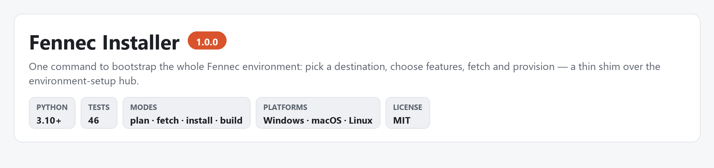

---

## At a glance

| Tests | Entry scripts | Exclusive modes | Layout dirs | Features (hub manifest) |
|:---:|:---:|:---:|:---:|:---:|
| 46 in 2 files | 3 | 3 (+ `--build` / `--update`) | 5 | 10 |

Counts from `tests/`, `bootstrap.py` and the hub's `repos.json`. Device detection,
dependency installation, engine builds and checkout updates all live in the
[hub](https://github.com/Liso7150/fennec-environment-setup) — not here.

## Flow

```
 python install.py / bootstrap.py
      │
      ├─ pick destination ──► interactive picker, --root <path> or --drive <letter>
      ├─ bootstrap hub ─────► clone / verify Liso7150/fennec-environment-setup (main only)
      ├─ choose features ───► menu, --features … or --all (dependency closure)
      └─ hand off to hub ───► plan ─► fetch ─► install ─► ~/.fennec/config.json
                            read-only   sources   deps + optional cargo build
```

The installer never downloads models and never starts a server. Only public GitHub sources
are fetched; nothing is uploaded.

## Prerequisites

| Requirement | Needed for |
|---|---|
| Python 3.10+ on PATH | everything |
| Git | cloning the hub and the suite |
| Rust (`cargo`) | `--build` only |

Nothing is installed system-wide and no PATH entry is changed permanently.

## Run

```bash
python install.py                                          # interactive menu
python install.py --features inference,desktop --yes        # fetch sources only
python install.py --all --yes                               # fetch everything
python install.py --update --yes                            # update installed checkouts
python install.py --install --features inference,desktop --yes
python install.py --install --features inference --build --yes
python install.py --features browser-outlets --yes          # clone Jev + OpenBot only
python bootstrap.py --plan --all                            # read-only plan
```

`install.py` is the compatibility entry point: with no explicit mode it selects
`--fetch-only`, preserving the historical "download the repos" behavior. `--plan`,
`--fetch-only`, `--install` and `--build` always win.

> [!IMPORTANT]
> `--yes` confirms an explicit action but never *selects* features. Noninteractive runs must
> pass `--features` or `--all` (or `--update` for installed checkouts).

### Modes

| Flag | Effect |
|---|---|
| `--plan` / `--dry-run` | print the plan; no mutation, no network |
| `--fetch-only` | clone or verify checkouts (the `install.py` default) |
| `--install` | fetch, then provision dependencies and write the config |
| `--build` | additionally `cargo build --release` the engine (implies `--install`) |
| `--update` | `git pull --ff-only` on installed clean checkouts |
| `--json` | machine-readable output (`--plan` only) |

`--plan`, `--fetch-only` and `--install` are mutually exclusive; `--build` cannot be
combined with `--fetch-only`. Installing provisions `python` on PATH and writes
`~/.fennec/config.json` **only after every action succeeds**.

### Overrides

| Kind | Flags |
|---|---|
| Roots | `--root`, `--drive`, `--setup-home`, `--engine-root`, `--suite-root`, `--models-root`, `--cache-root` |
| Config | `--python`, `--model`, `--engine-url`, `--web-root`, `--workspace`, `--backend`, `--policy`, `--ctx`, `--jev-root`, `--openbot-url`, `--native-target` |
| Manifest | `--manifest`, `--config` |

`--drive` and `--root` are alternatives; pass only one.

## Install destination

On an interactive run the installer lists the drives it finds with their free space, offers
the default (`~/Fennec`), accepts any drive letter or folder, then shows the layout before
anything is downloaded:

```
ROOT/engine   Fennec engine checkout (Rust; cargo build --release)
ROOT/suite    suite sources: desktop, core, CLI, plugins, fine-tuning, optional outlets
ROOT/models   model weights you add later (nothing is downloaded here)
ROOT/cache    pip / npm / Hugging Face caches
ROOT/setup    environment setup hub used by this installer
```

`--yes` keeps the default roots (`~/Fennec`, `~/Fennec-Suite`, `~/fennec-models`,
`~/.cache/fennec` on a fresh machine) or any roots passed explicitly. An existing
`~/Colibri` engine checkout is the fallback engine root when nothing chose one, and a
config that already points at a Colibri root keeps it. The shared config
`~/.fennec/config.json` is the one small file written outside the chosen root, because
every Fennec app reads it.

`--build` runs `cargo build --release` in `ROOT/engine`; the plan reports a missing `cargo`
as a requirement. The resulting `target/release/fennec(.exe)` is launched directly, with no
Python in front of it. A legacy Colibri root still builds through its `c/Makefile` /
`c/coli` launcher instead.

## Device detection

The hub probes NVIDIA (`nvidia-smi`), Vulkan, Metal (macOS), Intel NPU (OpenVINO), RAM and
free disk, then recommends a config. The recommendation is deliberately conservative: CPU
decoding at `policy=balanced` with a context window sized to the machine (for example an
8 GB GPU + 16 GB RAM → `ctx=4096`).

> [!NOTE]
> Seeing a GPU is not proof that a native accelerator backend was compiled, so the plan
> keeps CPU until you verify an engine build and switch `backend` yourself. The Intel NPU is
> an **embedding sidecar only**, never a decoder.

Selecting the `npu` feature installs the sidecar's imports (`openvino`,
`openvino-tokenizers`, `numpy`, `huggingface-hub`) and fetches the prebuilt OpenVINO IR
embedding model (`OpenVINO/bge-base-en-v1.5-int8-ov`) into
`<models_root>/embed/bge-base-en-v1.5-int8-ov`. Nothing exports the model itself: the plan
never installs `optimum-intel`, so torch and nncf stay out of that interpreter. Everything
is cached under `<cache_root>` and only runs in `--install` mode after you allow downloads.

## Platform support

| Platform | What runs |
|---|---|
| Windows / macOS / Linux | the installer directly, engine on device |
| Android, Termux | core + PWA locally via the `mobile` feature (see [`android/`](android/README.md)) |
| Android browser / iOS | PWA client of a Fennec host; on-device engine installation is refused |

Termux is treated as a local Linux userspace: the engine starts on demand there when a
compatible small model and ARM build exist. A 35B model is never expected to run on a phone.
There is **no APK build pipeline** — `android/webview/` is a scaffold, and the Android SDK
and Gradle are not shipped.

## Migrating an existing Colibri install

`migrate_rebrand.py` moves a pre-1.4 machine onto the Fennec names in one pass: the
suite/hub/models folders, `<root>/.cache/colibri-*`, `~/.colibri` → `~/.fennec`,
`~/.colibri-code` → `~/.fennec-desktop`, the roots inside `config.json`, the legacy
`acp.registry.colibri` records in Air's overlay and `installed.json`, the `Colibri` picker
entry, the `air.acp.registry.path` vmoption, and the model path in the engine's local stack
scripts.

```bash
python migrate_rebrand.py            # print the plan, change nothing
python migrate_rebrand.py --apply    # perform it
```

It is idempotent and stops at the first locked folder without rewriting any config, so a
failed run is safe to repeat. Every edited file keeps a `*.bak-fennec-rebrand` backup beside
it. The engine checkout is deliberately untouched — a Fennec root is recognised and
preserved exactly like the legacy `~/Colibri` with its `COLI_*` variables and `c/coli` entry
point. The stale desktop code index is retired rather than rewritten so the sidecar
rebuilds it.

> [!WARNING]
> Close Qoder and every JetBrains IDE first: Windows refuses to rename a directory while a
> process holds a file inside it open. On Windows, copy `migrate-fennec.bat` **outside** the
> suite (a drive root or `%USERPROFILE%` works) and run that — `cmd.exe` keeps a handle on
> the running batch file, and the copy also stages the Python script in `%TEMP%`.

Afterwards, install the desktop and plugin artifacts for the version you are on and start
the IDE once so it republishes the Fennec Air card. Build those artifacts yourself: the
plugin zip via
[`fennec-jetbrains/build-plugin.sh`](https://github.com/Liso7150/fennec-jetbrains), the
desktop installer via `npm run dist:exe` in
[`fennec-desktop`](https://github.com/Liso7150/fennec-desktop) (needs the core repo beside
it for the native addon). No prebuilt 1.0.0 desktop installer is committed to this suite.

## Tests

```bash
python -m unittest discover -s tests -v     # 46 checks across 2 files
```

Hermetic: temporary directories and mocks, no network client calls, no downloads, no
servers. A few bootstrap tests exercise real local `git init` / `remote add` in a temp
directory and skip when git is absent; none of them fetch.

## Credits

Engine: [Liso7150/fennec](https://github.com/Liso7150/fennec) — one native Rust engine
(`serve` / `run` / `info` / `plan` / `doctor`, OpenAI-compatible HTTP on `127.0.0.1:8184`).
Base idea: [JustVugg/colibri](https://github.com/JustVugg/colibri) — device-tiered MoE
inference, still supported as the legacy `c/coli` fallback. Fine-tuning:
[AirLLM](https://github.com/lyogavin/airllm). Browser outlets:
[Jev](https://github.com/browser-use/jev-ultrafast) and
[OpenBot](https://github.com/CopilotKit/OpenBot), used exactly as upstream. Part of the
[Fennec suite](https://github.com/Liso7150/fennec-environment-setup).